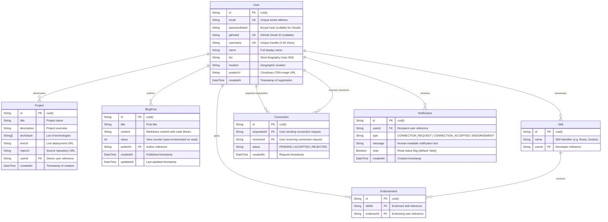

# DevConnect — Database Schema & Architecture Documentation

## Overview
DevConnect uses **PostgreSQL** managed through **Prisma ORM**. The data model is optimized for high-performance developer networking, social graph queries, portfolio showcases, technical blogging, and real-time event notifications.

---

## Entity-Relationship Diagram (ERD)

---

## Detailed Model Specifications

### 1. `User`
Core identity table supporting both local email/password credentials and GitHub OAuth 2.0.
* **Primary Key:** `id` (CUID string for collision-resistant, URL-safe distributed IDs).
* **Unique Constraints:** `email`, `username`, `githubId`.
* **Relations:**
  * `projects`: One-to-many with `Project` (cascades on delete).
  * `posts`: One-to-many with `BlogPost` (cascades on delete).
  * `skills`: One-to-many with `Skill` (cascades on delete).
  * `endorsementsGiven`: One-to-many with `Endorsement` (cascades on delete).
  * `sent`: One-to-many with `Connection` as requester.
  * `received`: One-to-many with `Connection` as receiver.
  * `notifications`: One-to-many with `Notification` (cascades on delete).

### 2. `Project`
Developer portfolio items showcasing applications, repositories, and technology stacks.
* **Foreign Key:** `userId` -> `User.id` (ON DELETE CASCADE).
* **Attributes:**
  * `techStack`: Postgres string array (`String[]`) enabling multi-tag filtering without requiring an intermediary join table.
  * `liveUrl` / `repoUrl`: Optional sanitized URLs pointing to live deployments and git repositories.

### 3. `BlogPost`
Technical articles supporting GitHub Flavored Markdown (GFM) and syntax-highlighted code.
* **Foreign Key:** `authorId` -> `User.id` (ON DELETE CASCADE).
* **Attributes:**
  * `views`: Integer counter atomically incremented via Prisma's `increment: 1` upon single post retrieval (`GET /api/posts/:id`).
  * `updatedAt`: Auto-managed timestamp for content revisions.

### 4. `Skill`
Verified technical abilities associated with developer profiles.
* **Foreign Key:** `userId` -> `User.id` (ON DELETE CASCADE).
* **Composite Unique Constraint:** `@@unique([userId, name])` prevents duplicate skill entries per user while allowing case-insensitive matching in application logic.

### 5. `Endorsement`
Peer validation of skills between connected developers.
* **Foreign Keys:**
  * `skillId` -> `Skill.id` (ON DELETE CASCADE).
  * `endorserId` -> `User.id` (ON DELETE CASCADE).
* **Composite Unique Constraint:** `@@unique([skillId, endorserId])` enforces the strict business rule that each developer can endorse a specific skill at most once.
* **Business Rule Validation:** Endorsement endpoints verify bidirectional `ACCEPTED` connection status before creating records.

### 6. `Connection`
Bidirectional social networking graph modeling professional connections.
* **Foreign Keys:**
  * `requesterId` -> `User.id` (ON DELETE CASCADE).
  * `receiverId` -> `User.id` (ON DELETE CASCADE).
* **Composite Unique Constraint:** `@@unique([requesterId, receiverId])` prevents duplicate request spam.
* **Statuses:**
  * `PENDING`: Request sent, awaiting receiver action.
  * `ACCEPTED`: Established connection; enables skill endorsements and activity feed syndication.
  * `REJECTED`: Cleanly removed or declined.

### 7. `Notification`
Real-time and persistent notification records delivered over Socket.io and stored in database.
* **Foreign Key:** `userId` -> `User.id` (ON DELETE CASCADE).
* **Attributes:**
  * `type`: Categorical identifier (`CONNECTION_REQUEST`, `CONNECTION_ACCEPTED`, `ENDORSEMENT`).
  * `read`: Boolean flag toggled when user clicks notification bell.

---

## Indexing & Query Optimizations

1. **User Discovery & Search:**
   * Text search queries (`q`, `skill`, `location`) utilize indexed fields and subquery relations (`skills.some`).
2. **Mutual Connection Calculation:**
   * Calculated through the optimized `connectedIds(userId)` helper querying `Connection` on `status: 'ACCEPTED'` with index on `[requesterId, receiverId]`.
3. **Feed & Trending Queries:**
   * Feed queries order by `createdAt: 'desc'` with `take: 10` filtering on author IDs in the connection set.
   * Trending posts order by `views: 'desc'` with `take: 5`.
