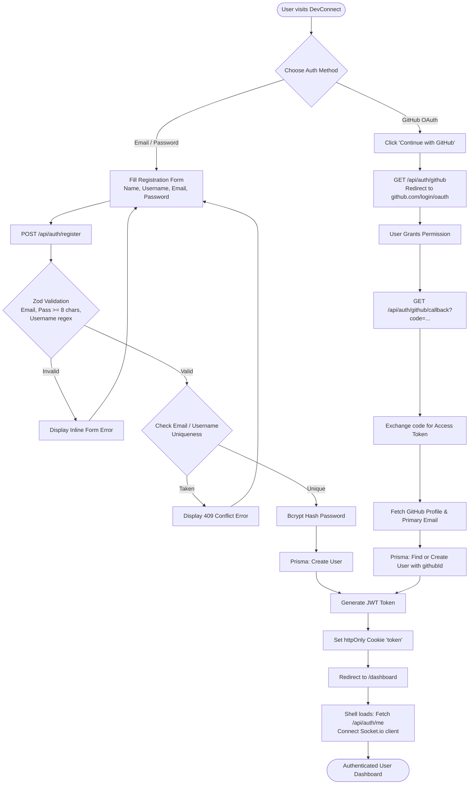
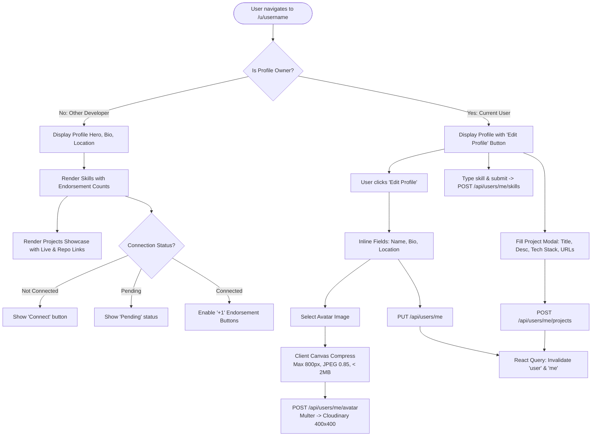
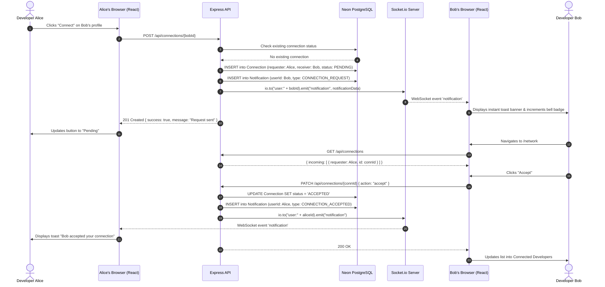
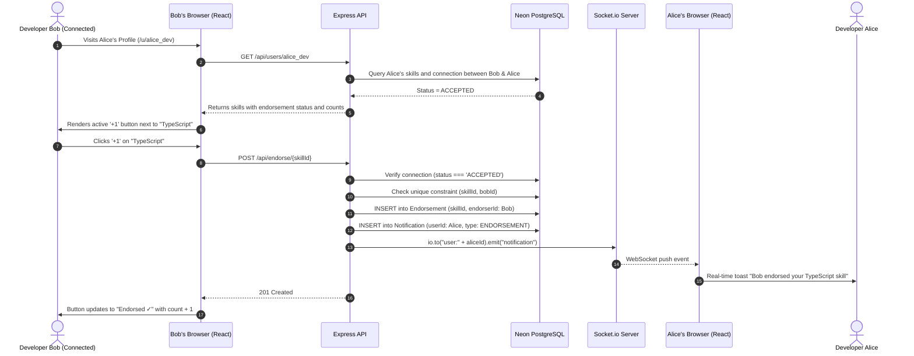

# DevConnect — User Flow Diagrams

This document illustrates the end-to-end user journeys and system interactions for all primary capabilities in the DevConnect platform.

---

## 1. User Registration & Authentication Flow

### Local Email/Password and GitHub OAuth 2.0



---

## 2. Profile Management & Project Showcase Flow



---

## 3. Connection Request Lifecycle



---

## 4. Skill Endorsement & Real-Time Notification Flow



---

## 5. Technical Blog System Lifecycle

```mermaid
flowchart LR
    Write[Author writes Markdown in Editor] --> LivePreview[Rehype-Highlight parses & renders side-by-side preview]
    LivePreview --> Publish[Click 'Publish' -> POST /api/posts]
    Publish --> StorePost[Prisma stores Markdown string in PostgreSQL]
    StorePost --> InvalidateBlog[React Query updates feed]
    InvalidateBlog --> ReaderVisits[Other developer navigates to /blog/:id]
    ReaderVisits --> IncViews[Prisma atomically increments 'views: { increment: 1 }']
    IncViews --> RenderGfm[ReactMarkdown renders formatted code blocks & headings]
```
