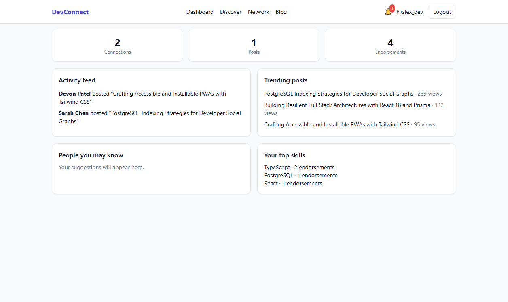
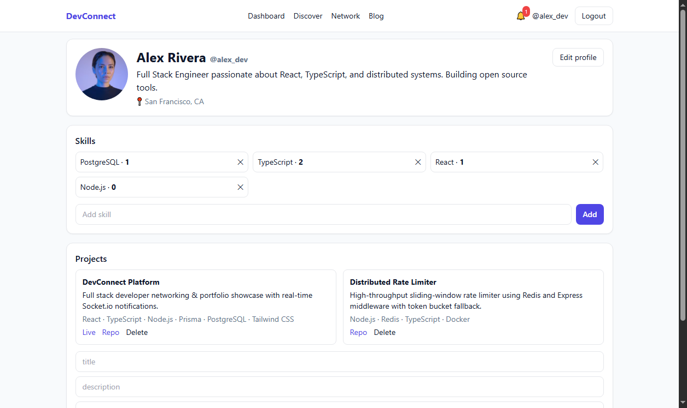
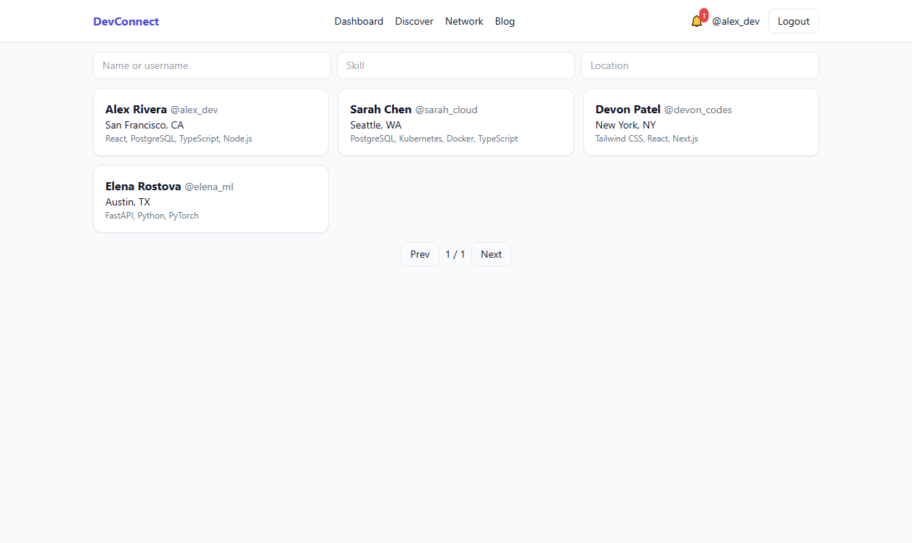
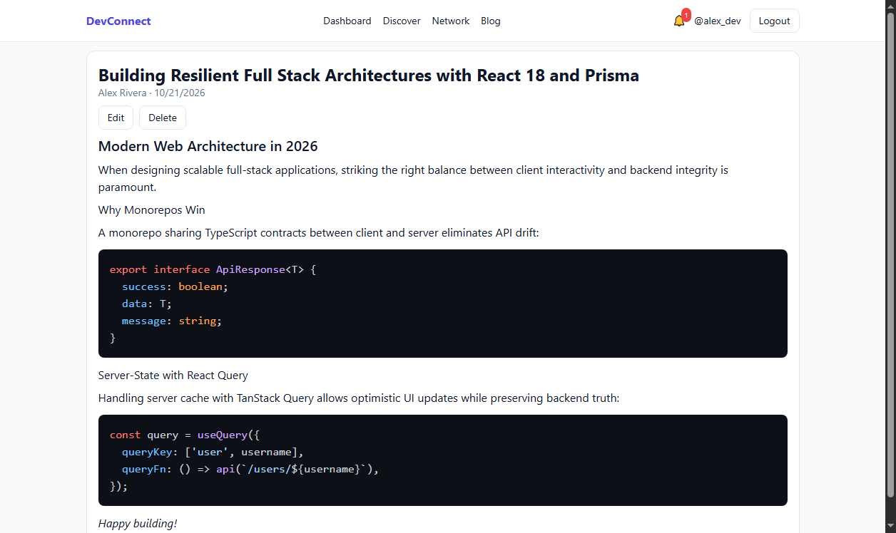
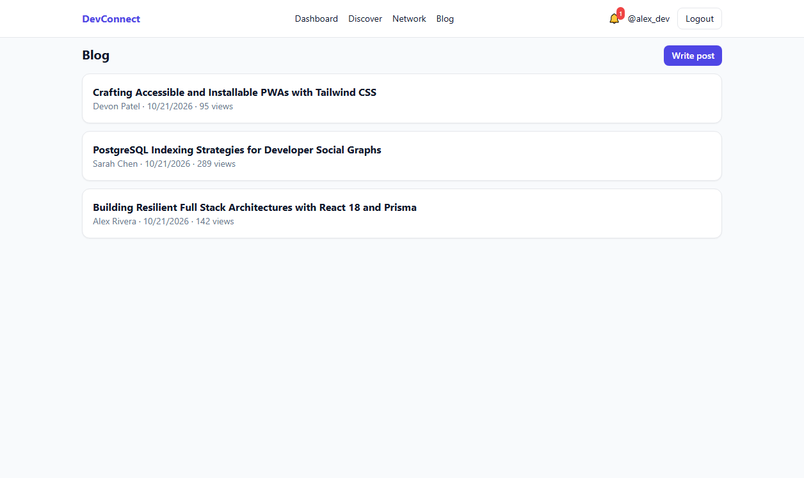
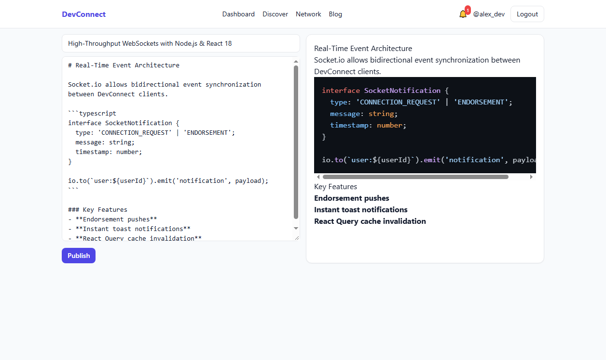
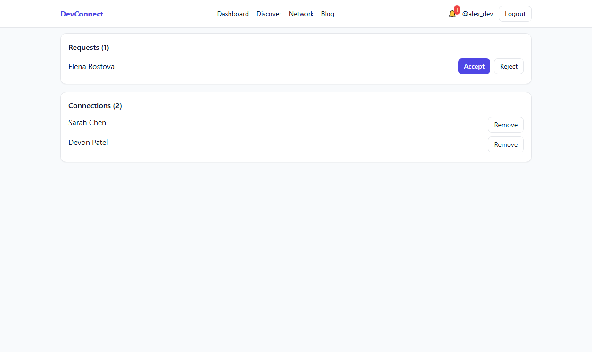
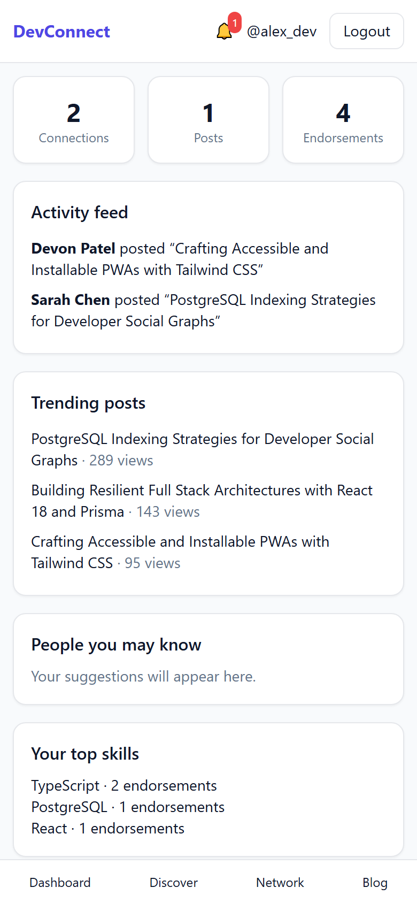
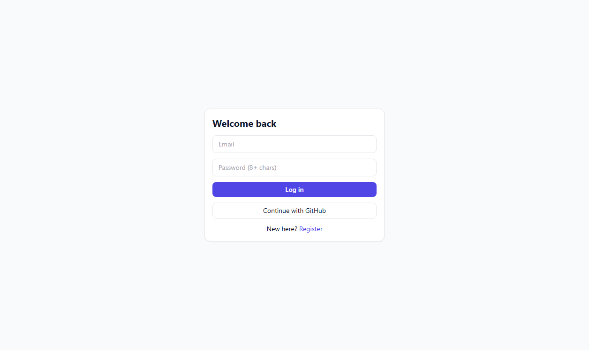
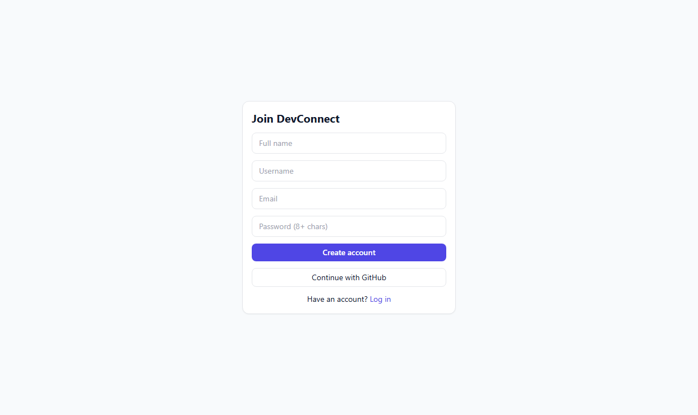

# DevConnect — Platform UI & Feature Screenshots

This directory contains high-resolution demo screenshots of the running **DevConnect** application across all core features and device breakpoints.

---

### 1. Developer Dashboard & Activity Feed
Real-time stats counter (connections, posts, endorsements), peer activity feed, trending posts, and skill recommendations.

---

### 2. Developer Profile & Portfolio
Rich developer portfolio featuring bio, location, mutual connections, live project links, and skill endorsements count (`+1`).

---

### 3. Developer Discovery & Search
Case-insensitive search with skill and location filters, dynamic result count, and pagination.

---

### 4. Technical Blog System
Markdown-powered publication engine with dark-mode syntax highlighting via `rehype-highlight` and view tracking.

---

### 5. Technical Blog List
Paginated feed of community articles with author metadata, date, and view metrics.

---

### 6. Split-Pane Live Markdown Editor
Instant side-by-side editing and rendering with syntax highlighting and formatting support.

---

### 7. Connection Network
Incoming and outgoing connection requests management with one-click Accept/Reject and peer removal.

---

### 8. Mobile-Responsive Layout (PWA)
Full responsive design with fixed bottom navigation bar and touch interactions.

  

---

### 9. Authentication Views (Login & Register)
Secure dual-mode authentication via email/password and GitHub OAuth.

| Login View | Registration View |
| :---: | :---: |
|  |  |
